### about

I want to break things for a living. Ethically.<br/>
So I'm learning how they're built first: **C, memory, Linux, networks**.<br/>
`NullMalloc` is named after the bug I check for the most.

Daily driver: a **Librebooted ThinkPad T480**. Yes, I like knowing what runs on my machine.

### what I bring

| | |
|---|---|
| **Security** | CompTIA Security+ certified · [verify](https://cp.certmetrics.com/comptia/en/public/verify/credential/b4fd7baed9d5474e8b6815ba6344bdc2) |
| **Networking** | routing, switching, subnetting, VLANs · studied the CCNA curriculum · [my notes](https://github.com/NullMalloc/CCNA) |
| **Pentesting** | recon, enumeration, web & AD basics · TCM PJPT training · [TryHackMe](https://tryhackme.com/p/TMp4x3iDFF) |
| **Low-level** | C, pointers, memory management · 42 Nice |

### 42 journey

| Project | Status | What it taught me |
|---|---|---|
| [**libft**](https://github.com/NullMalloc/libft) | **100/100** | memory, pointers, linked lists, handling every `malloc` failure without a leak |
| **ft_printf** | in progress | variadic functions, number bases, formatted output |
| **get_next_line** | next | file descriptors, static variables, buffers |
| **push_swap** | next | sorting algorithms, complexity, two stacks |

### offensive practice

- **TryHackMe**, Jr Penetration Tester path: recon, enumeration, web exploitation, getting that first shell
- **Tools I've used so far:** `nmap`, `gobuster`, `netcat`
- **Roadmap:** PJPT → CPTS (Hack The Box) → OSCP (OffSec)
- **Coming soon:** my first CTF write-ups, in this account

### how I work

- **If I can't explain it, it's not done.** I'd rather understand one function than copy ten.
- **I trace code by hand** before I trust it: variables, boxes, arrows.
- **Every `malloc` gets a NULL check.** Hence the name.

### learning.log

```console
[2026-09]    survived the 42 Piscine
[2026-11-02] started libft
[2026-11-17] beat ft_split, the boss of part 2
[2026-11-18] libft validated, 100/100
[now]        ft_printf + TryHackMe
```

<sub>[TryHackMe](https://tryhackme.com/p/TMp4x3iDFF) · [Security+ verification](https://cp.certmetrics.com/comptia/en/public/verify/credential/b4fd7baed9d5474e8b6815ba6344bdc2) · [libft](https://github.com/NullMalloc/libft) · [CCNA notes](https://github.com/NullMalloc/CCNA)</sub>
