Hey, I'm Sami 👋

I'm a student at 42 Nice, where I write C all day with no libraries and no shortcuts.
My goal is to become a pentester. I already have my CompTIA Security+ and I studied the CCNA,
so I know the theory. At 42, I'm learning how things really work underneath, because I don't think
you can hack something properly if you don't understand how it was built.

My username comes from the one bug I check for the most: `malloc` returning `NULL`.

```gdb
(gdb) bt
#0  ft_printf (const char *fmt, ...)  at 42/rank1.c
#1  libft (score=100, functions=43)   at 42/rank0.c
#2  piscine (status=ADMITTED)         at 42/nice.c
#3  main (int argc, char **argv)      at sami.c
(gdb) info certs
CompTIA Security+    CERTIFIED
(gdb) continue
next: PJPT -> CPTS (Hack The Box) -> OSCP
```

### rules I code by

- Every `malloc` gets a `NULL` check. Every single one.
- Every allocation has an owner, and every owner frees it. If one `malloc` fails, everything before it gets freed too.
- `-Wall -Wextra -Werror -fsanitize=address`, or it didn't happen.
- I trace my code by hand before I trust it.
- If I can't explain it, it's not done.

### proof, not promises

[Security+ (verify)](https://cp.certmetrics.com/comptia/en/public/verify/credential/b4fd7baed9d5474e8b6815ba6344bdc2) · [libft](https://github.com/NullMalloc/libft) · · [TryHackMe](https://tryhackme.com/p/NULLMALLOC)

<sub>No memory was leaked in the making of this profile.</sub>
